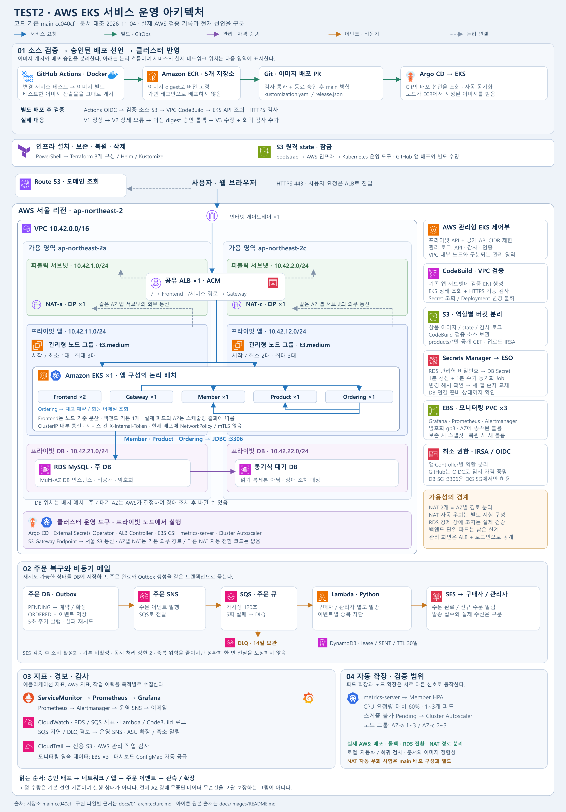

# TEST2 · AWS EKS 쇼핑몰 인프라와 서비스 운영

Terraform으로 2개 가용 영역에 인프라를 만들고, **테스트한 이미지를 동료 승인 후 GitOps로 배포**하는 프로젝트입니다. 회원·상품·주문 서비스의 배포뿐 아니라 주문 복구, 메일 처리, 자동 확장, 비밀번호 갱신, 데이터 보존·복원과 전체 삭제까지 다룹니다.

> **문서 기준:** 2026-11-04에 main `cc040cf`의 코드와 보관된 실행 기록을 대조했습니다. NAT 2개·RDS Multi-AZ는 2026-11-02 실제 구축 기록이 있습니다. 현재 AWS 자원이 실행 중이라는 뜻은 아닙니다. 이 문서 작업에서는 AWS를 새로 구축하지 않았습니다. [검증 범위와 근거](docs/21-current-validation.md)



[SVG 원본으로 확대](docs/images/architecture.svg) · [구현 파일별 근거](docs/01-architecture.md) · [아이콘 출처](docs/images/README.md)

## 먼저 볼 문서

| 목적 | 문서 |
|---|---|
| 전체 구조·설계 선택·남은 한계 | [아키텍처](docs/01-architecture.md) |
| 승인 배포·CodeBuild·GitOps | [배포 자동화](docs/02-deployment.md) |
| 주문 복구·Outbox·메일·관측 | [서비스 운영과 장애 대응](docs/03-monitoring-and-tests.md) |
| 무엇을 실제로 시험했는가 | [AWS / 로컬 검증 구분](docs/21-current-validation.md) |
| 설치부터 삭제까지 | [PS1 실행 가이드](docs/15-one-command-lab.md) · [보존·복원 상세](docs/16-integrated-operations.md) |
| 배포 버전과 복구 | [V1 → V2 → 롤백 → V3](docs/RELEASES.md) · [롤백 절차](docs/ROLLBACK.md) |
| 예전 실습의 원문 | [기록 목록과 문서의 적용 범위](docs/README.md) |

## 핵심 구성

| 영역 | 현재 코드의 구현 |
|---|---|
| 네트워크 | 서울 리전, VPC 1개, AZ 2개, 퍼블릭·앱·DB 서브넷 각 2개, AZ별 NAT 2개, S3 Gateway Endpoint |
| 앱 실행 | EKS 1개, t3.medium 관리형 노드 기본 3대, Frontend 2개, Gateway·Member·Product·Ordering 기본 각 1개 |
| 접속 | Route 53·공유 ALB·ACM, 사이트 / Argo CD / Grafana의 호스트·경로 분기 |
| 데이터 | 비공개 RDS MySQL Multi-AZ, 상품 이미지 S3, 모니터링 EBS PVC 3개 |
| 자격 증명 | RDS 관리형 Secrets Manager → ESO → Kubernetes Secret → 변경 감지 Job의 순차 앱 갱신 |
| 이벤트 | 주문 Outbox → SNS → SQS → Lambda → SES, DLQ와 DynamoDB 중복 제어 |
| 배포 | Actions·Docker·ECR digest·승인 PR·Argo CD, VPC CodeBuild의 배포 후 조회 검증 |
| 관측·확장 | Prometheus·Grafana·Alertmanager, CloudWatch·CloudTrail, Member HPA·Cluster Autoscaler |

기본 선언과 실제 실행 수량은 구분합니다. 옵션과 입력에 따라 리소스 생성 여부가 달라지며, 특히 주문 메일은 발신자 설정과 SES 인증 후 소비자를 활성화해야 합니다.

## 사용자 요청과 주문 처리

브라우저는 ALB를 통해 프런트엔드를 받고, `/member-service`·`/product-service`·`/ordering-service` 요청은 API Gateway 파드로 전달합니다. Gateway는 내부 ClusterIP 서비스로 라우팅합니다. Member·Product·Ordering은 같은 RDS 인스턴스의 DB를 사용하며, Ordering은 Product의 재고 예약과 Member의 이메일 조회 API도 호출합니다.

주문은 Idempotency-Key와 DB 상태를 이용해 중복 요청·중간 실패를 복구합니다. 재고 예약·확정 과정과 보상 상태를 저장하고, 완료 시 **ORDERED 변경과 Outbox 생성을 같은 DB 트랜잭션**으로 처리합니다. 이후 별도 작업이 SNS로 발행합니다. 외부 API까지 하나의 분산 트랜잭션으로 묶거나 정확히 한 번 처리한다고 주장하지 않습니다.

Lambda는 SQS 메시지를 받아 구매자·관리자 메일을 구분해 보내고, DynamoDB에 이벤트별 처리 상태를 남깁니다. 재시도 실패는 DLQ로 이동합니다. SES 접수 성공과 실제 받은편지함 도착은 별도로 확인했습니다.

## 배포와 복구

1. Actions가 변경 서비스를 골라 테스트하고 Docker 이미지를 만듭니다.
2. 테스트한 이미지 산출물을 ECR에 게시하고 digest를 고정한 **배포 PR**을 제안합니다.
3. 필수 검사·동료 검토 후 main에 병합하면 Argo CD가 Git의 배포 선언을 동기화합니다. 노드는 ECR에서 이미지를 받습니다.
4. 배포 후 Actions가 VPC CodeBuild를 실행해 revision·이미지·가용성·TLS·HTML·상품 API를 검사합니다. 이 역할은 배포 변경 및 Secret 조회 권한을 갖지 않습니다.
5. 문제 발생 시 이전 검증 digest를 복구하는 PR을 만듭니다. DB·인프라는 자동 롤백하지 않습니다.

실제 시연에서는 **V1 정상 화면 → V2 상품 상세 오류 → V1 이미지 롤백 → V3 수정 배포**를 확인했습니다. V2는 Pod Healthy·HTTP 200·목록 API 정상만으로 사용자 동작 오류를 잡을 수 없다는 사례였고, V3에 카드→상세 회귀 검사를 추가했습니다. [배포 이력](docs/RELEASES.md)

## 검증 결과를 읽는 기준

| 구분 | 확인한 내용 | 범위 |
|---|---|---|
| AWS · 10월 기록 | HPA·노드 확장/축소, DB 비밀번호 회전, CodeBuild 권한, 스냅샷 보존·복원·데이터 비교, 메일 수신, 삭제 | 각 기록의 당시 구성 기준 |
| AWS · 11월 2일 | NAT 2개·RDS Multi-AZ 최초 구축, 승인 재배포·롤백·수정, RDS 강제 장애 조치의 실제 연결 대상 c→a와 앱 복구, NAT 경로 분리 | 현재 HA 선언과 배포 시연의 근거 |
| AWS · 11월 3일 별도 시험 | NAT-a 장애 주입 → NAT-c 자동 우회 → 회복 확인 후 복귀 | **별도 최소 환경의 컨트롤러 시험. 현재 main에는 미통합** |
| 로컬 · 문서 최신화 | 자동화 단위 검사·프런트 회귀 검사·문서 링크·SVG/PNG 정합성 | [실행 결과와 한계](docs/21-current-validation.md) |

## 설치·검증·보존·삭제

현재 출발점은 **main과 PS1**입니다. 예전 `test`·`test2`·`build2/*` 브랜치 안내 및 GUI 자료는 과거 기록입니다. AWS CLI 자격 증명·권한, Terraform, Helm, kubectl, Python 등 사전 도구와 입력값을 [실행 가이드](docs/15-one-command-lab.md)에서 먼저 확인하세요. `scripts/ops/environment.json`과 backend·도메인·계정 값의 일치가 필요하며, 다른 계정에 그대로 실행하면 되는 범용 설치기는 아닙니다.

```powershell
git switch main
git pull --ff-only
.\Install-Lab.ps1           # 단계 미리보기
.\Install-Lab.ps1 -Execute  # 승인한 환경에 실제 생성·재개
.\Verify-Lab.ps1            # 기본 상태 검증
.\Remove-Lab.ps1            # 삭제 계획 미리보기
```

데이터를 보존하는 종료는 스냅샷·복구 자료 준비 후 실행 환경을 내립니다. 이 방식은 VPC·NAT 등 보존 자원의 비용을 남깁니다. 복구 자료의 Windows 사용자·PC 의존성도 있어 팀 공용 재해 복구 체계와는 다릅니다.

**완전 폐기를 결정한 경우에만** `Remove-Lab.ps1 -Execute -DiscardData`를 사용합니다. 데이터·이미지·로그·기록한 백업과 state 버킷까지 제거하는 절차이며, 도메인 등 기존 공용 자원은 소유권 기준으로 구분합니다. 현재 계정 전체의 비용 0원을 보장하는 명령은 아닙니다. state는 관리 자원 정리가 끝난 뒤 마지막에 처리합니다.

## 설계상 남은 경계

- AZ별 NAT는 장애 영향을 분리합니다. **다른 NAT로 자동 전환하는 코드는 main에 없습니다.** 11월 3일 별도 시연 결과를 기본 기능으로 설명하지 않습니다.
- RDS Multi-AZ는 대기 DB와 장애 조치를 제공하지만 읽기 확장 기능이 아니며, 전환 중 연결 재시도가 필요합니다. 실제 AZ 전체 장애를 재현한 시험은 아닙니다.
- Frontend는 2개지만 백엔드는 기본 각 1개입니다. HPA 활성 대상은 Member뿐이며 모든 서비스의 무중단을 보장하지 않습니다.
- 상품 S3의 `products/*`는 공개 읽기 경로입니다. 전체 버킷이 비공개라는 설명은 맞지 않습니다.
- Argo CD·Grafana는 인터넷 공개 관리 화면입니다. 로그인 보호는 있지만 사설 전용 접속이나 NetworkPolicy·mTLS 구성은 아닙니다.
- RDS 백업 보존 1일·삭제 보호 해제 등 실습 기본값은 실제 운영의 데이터 보존 정책과 다릅니다.

## 저장소 구조

```text
terraform-state-bootstrap/  원격 state 저장소
terraform/                  VPC·EKS·RDS·메시징·검증 IAM 등 AWS 자원
terraform-k8s/              Helm 기반 운영 도구·스토리지·자격 증명 연계
app/msa/                    다섯 서비스·Kustomize·Ingress·HPA·DB 동기화 Job
.github/workflows/          검사·이미지 게시·승인 확인·CodeBuild 검증
scripts/                    설치·검증·보존·복원·삭제·롤백 자동화
deploy/release.json         서비스별 소스 SHA·digest·배포 출처
docs/                       현재 설명·원문 기록·아키텍처 이미지
```
