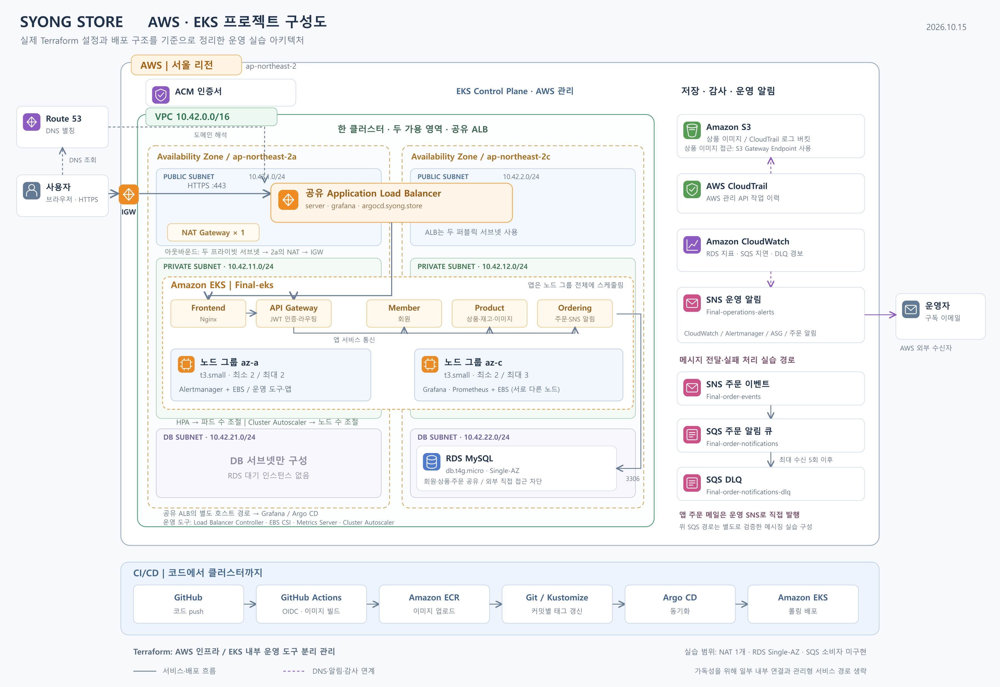

# AWS · EKS 서비스 운영 프로젝트

Terraform으로 AWS 인프라를 구성하고, GitHub Actions와 Argo CD로 앱을 배포한 운영 실습 프로젝트입니다.

앱 기능 자체보다는 **배포 자동화, 모니터링, 자동 확장, 장애 복구**를 직접 확인하는 데 집중했습니다.



## 프로젝트 문서

전체 내용을 한 페이지에 넣기보다 주제별로 나눴습니다.

| 페이지 | 내용 |
| --- | --- |
| [프로젝트 구성](docs/01-architecture.md) | 구성도, 주요 서비스, Terraform 폴더 분리 |
| [배포 자동화](docs/02-deployment.md) | GitHub Actions → ECR → Argo CD → EKS |
| [모니터링과 실습 결과](docs/03-monitoring-and-tests.md) | 지표·이메일 알림, 자동 확장, 메시징 검증 |
| [문제 해결 기록](docs/04-troubleshooting.md) | Grafana 503, 관리자 로그인, Terraform 오류 |
| [프로젝트 회고](docs/05-retrospective.md) | 배운 점과 실습 범위 |

## 사용 기술

- **인프라:** Terraform · VPC · EKS · IAM · ALB · Route 53 · ACM
- **배포:** Docker · ECR · GitHub Actions · Argo CD · Helm · Kustomize
- **데이터·운영:** RDS · S3 · EBS · Prometheus · Grafana · SNS · SQS · CloudWatch · CloudTrail

## 저장소 구조

```text
.
├── terraform/          # AWS 인프라
├── terraform-k8s/      # EKS 내부 운영 도구
├── app/msa/            # 앱 코드와 배포 매니페스트
├── .github/workflows/  # 이미지 빌드·배포 태그 갱신
└── docs/               # 구성·실습·문제 해결 기록
```

## 확인한 결과

- GitHub 코드 변경부터 실제 홈페이지 반영까지 배포 흐름 확인
- 파드 재생성·재배치와 파드·노드 수 변화 확인
- 운영 경보와 주문 알림 이메일 수신
- SNS → SQS → DLQ 전달 및 CloudWatch 경보 확인
- CloudTrail 작업 이력과 S3 로그 확인
- 최종 Terraform validate 성공, 두 구성 모두 plan에서 No changes 확인

웹사이트·Grafana·Argo CD는 공유 ALB와 개별 도메인으로 연결했습니다. 실습 인프라를 삭제한 동안에는 접속되지 않습니다.

단일 파드와 Single-AZ RDS 등을 포함한 실습 구성으로, 모든 장애에서 무중단을 보장하는 구조는 아닙니다.
