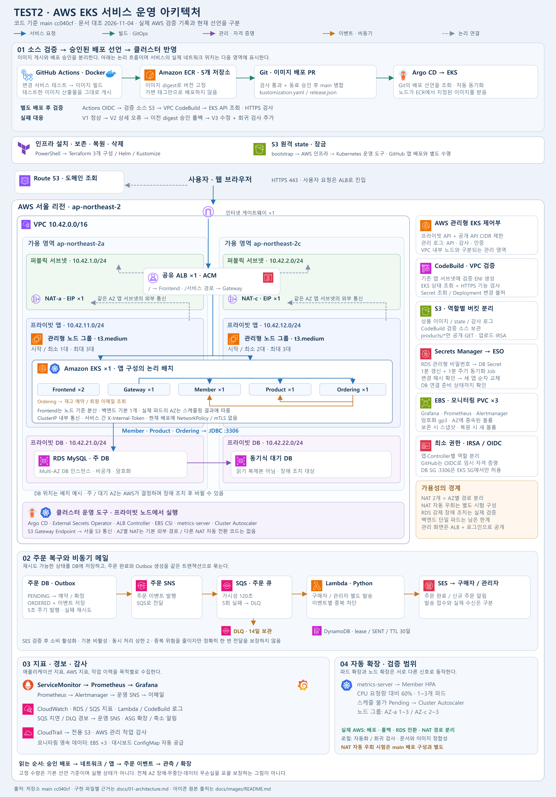

# 현재 아키텍처와 구현 근거

2026-11-04에 main `cc040cf`를 대조한 설명입니다. 수량은 기본 선언이며 실행 중인 AWS 자원 목록이 아닙니다. [검증 범위](21-current-validation.md) · [문서 목록](README.md)

[확대 가능한 SVG](images/architecture.svg) · [로고 출처](images/README.md)

## 네트워크 계층과 가용성

| 계층 | 코드의 선언 | 근거 |
|---|---|---|
| 리전·VPC | ap-northeast-2, 10.42.0.0/16, AZ-a / AZ-c | [변수](../terraform/variables.tf), [공통 환경](../scripts/ops/environment.json) |
| 퍼블릭 | 10.42.1.0/24 / 10.42.2.0/24, IGW, NAT와 EIP 각 2개 | [VPC와 라우트](../terraform/network/main.tf) |
| 앱 프라이빗 | 10.42.11.0/24 / 10.42.12.0/24, 각각 같은 AZ NAT 사용 | [라우팅](../terraform/network/main.tf) |
| DB 프라이빗 | 10.42.21.0/24 / 10.42.22.0/24, RDS DB subnet group | [RDS](../terraform/rds/main.tf) |
| S3 접근 | 두 앱 라우팅 테이블의 S3 Gateway Endpoint | [Endpoint](../terraform/network/endpoints.tf) |
| EKS 노드 | t3.medium, a 최소/시작 1·최대 3 / c 최소/시작 2·최대 3 | [노드 그룹](../terraform/eks.tf) |
| DB | MySQL 8.4.11, db.t4g.micro, Multi-AZ, 20GB 암호화 gp3, 비공개 | [RDS](../terraform/rds/main.tf) |

NAT는 AZ별로 나눠 외부 통신의 장애 범위를 줄입니다. 이 라우팅은 다른 NAT의 상태를 감지하거나 자동 우회하지 않습니다. RDS는 주 DB와 동기식 대기 DB를 사용하며 대기 DB는 읽기 복제본이 아닙니다. 그림의 주/대기 위치는 예시입니다. 실제 연결 대상은 장애 조치 후 달라집니다.

EKS 제어부는 AWS 관리 영역입니다. VPC에는 노드와 파드가 있으며, API는 프라이빗 접근과 CIDR 제한 공개 접근을 함께 사용합니다. “EKS 전체가 사설 전용”인 구성으로 해석하지 않습니다.

## 요청과 내부 통신

1. Route 53은 호스트 주소를 조회합니다. HTTPS 요청 본문이 DNS 서버를 거쳐 가는 것은 아닙니다.
2. 공유 ALB는 ACM 인증서를 사용하고 HTTP를 HTTPS로 전환합니다. `/`는 Frontend, 서비스별 API 경로는 Gateway로 보냅니다.
3. 브라우저의 API 호출이 ALB→Gateway→내부 서비스로 연결됩니다. Frontend 서버가 모든 API의 중계자인 구조는 아닙니다.
4. Gateway는 접두 경로를 제거하고 Member·Product·Ordering의 ClusterIP로 전달합니다.
5. Ordering은 Product의 재고 예약·확정·해제와 Member의 이메일 조회 API도 직접 호출합니다. 세 서비스는 같은 RDS DB를 사용합니다.

근거: [Ingress](../app/msa/k8s/k8s-services/ingress.yml), [Gateway 경로](../app/msa/apigateway/src/main/resources/application-prod.yml), [주문 서비스 코드](../app/msa/ordering/src/main/java/com/example/ordersystem/ordering/service), [활성 Kustomize 자원](../app/msa/kustomization.yaml).

Frontend 기본 2개는 노드 기준 분산·PDB·롤링 업데이트 설정을 사용합니다. 한 개씩 서로 다른 AZ에 반드시 배치된다는 의미는 아닙니다. 백엔드와 Gateway 기본값은 각각 1개입니다. YAML 파일이 존재하더라도 Kustomize에서 활성화하지 않은 HPA는 운영 대상에 포함하지 않습니다.

## 저장소와 자격 증명

- **상품 S3:** Product IRSA로 업로드합니다. `products/*` 객체는 공개 GET을 허용하므로 브라우저의 이미지 직접 조회 경로가 있습니다. [버킷 정책](../terraform/s3/main.tf)
- **나머지 S3:** 원격 state, CloudTrail 감사 로그, CodeBuild 검증 소스는 역할별 버킷으로 분리합니다. state 내용은 공개 문서·사진에 포함하지 않습니다.
- **모니터링 EBS:** Grafana·Prometheus·Alertmanager PVC 3개를 암호화 gp3로 연결합니다. EBS는 AZ에 종속되며 다른 AZ로 그대로 이동하는 공용 디스크가 아닙니다. [스토리지·Helm 구성](../terraform-k8s)
- **DB 비밀번호:** RDS 관리형 Secret→ESO→`db-credentials`→변경 해시를 확인하는 CronJob 순서입니다. Job은 Member·Product·Ordering을 순차 갱신하고 DB readiness를 기다립니다. [Secret 차트](../terraform-k8s/charts/database-secret/templates/secret.yaml), [동기화 Job](../app/msa/ops/db-credential-sync.yml)
- **권한:** 앱별 IRSA, GitHub OIDC, 검증 전용 EKS 조회 RBAC를 사용합니다. DB 3306은 EKS 보안 그룹에서만 허용합니다. JWT·내부 API 토큰은 별도 Secret으로 공급합니다. NetworkPolicy·mTLS나 모든 구간 TLS를 구현한 것으로 설명하지 않습니다.

## 배포·이벤트·운영의 연결

배포는 [승인 PR·GitOps·CodeBuild](02-deployment.md), 주문과 관측은 [서비스 운영](03-monitoring-and-tests.md)에 설명합니다. CodeBuild는 기존 앱 서브넷 안에 ENI를 만들어 EKS API를 조회합니다. ECR 이미지 전송과 Argo CD의 Git 조회는 다른 경로입니다.

인프라 Terraform, Kubernetes 운영 도구 Terraform, state bootstrap은 실행 순서와 관리 범위를 분리합니다. 보존 종료에서 데이터뿐 아니라 VPC·NAT가 남을 수 있어 비용도 남습니다. 완전 폐기는 Kubernetes 종속 자원→AWS 관리 자원→백업·잔여물→state 저장소 순서로 정리합니다. [PS1 가이드](15-one-command-lab.md), [보존·복원](16-integrated-operations.md)

## 개선된 부분과 아직 남은 부분

| 설계 선택 | 얻는 점 | 한계 |
|---|---|---|
| NAT 1개에서 AZ별 2개로 | 한쪽 경로 장애를 다른 AZ와 분리 | main에 자동 우회 컨트롤러 없음, 비용 증가 |
| RDS Single-AZ에서 Multi-AZ로 | 대기 DB 기반 장애 조치 | 읽기 확장 아님, 전환 중 연결 중단 가능 |
| 승인된 digest 배포 | 검증한 이미지와 배포 버전의 추적 | 승인 대기와 이미지 보존 정책 관리 필요 |
| Outbox·중복 제어 | DB 완료와 발행 의도 연결, 반복 처리 감소 | 외부 전달의 정확히 한 번 보장 아님 |
| 스냅샷 보존·복원 자동화 | 실행 환경 재생성 시 데이터 비교 가능 | 복구 자료의 동일 Windows 사용자·PC 의존, 공용 DR 미구현 |

초기 NLB·NGINX Ingress·cert-manager 자료와 이전 NAT 1개 기록은 [과거 문서](README.md)에 남깁니다. 현재 진입 경로는 공유 ALB·ACM이며 오래된 매니페스트가 현재 활성 경로를 뜻하지 않습니다.
